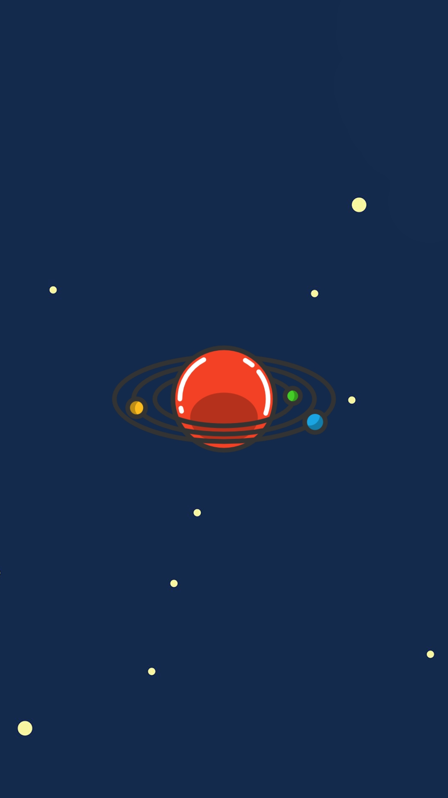

# Space – Wallpapers for Zooper

Wallpaper pack for **Space**, a theme for [Zooper Widget](https://en.wikipedia.org/wiki/Zooper_Widget) (Android). The theme's app reads [`Space_wallpaper.json`](Space_wallpaper.json) and downloads the images directly from this repository.

- **Contents:** 22 wallpapers (JPG) with thumbnails · `Space_wallpaper.json` (list of images and names) · the *Yellowtail* font used by the theme
- **App:** [Space for Zooper](https://play.google.com/store/apps/details?id=com.devsociety.space) on Google Play
- **Status:** discontinued (2016), still available for download

## Project status

**Space for Zooper is discontinued** and will not receive further updates, because:

- the project has been abandoned;
- Zooper Widget, the app this theme is built for, is no longer supported;
- the original Android Studio source files have been lost.

The app will stay online on Google Play: **[Space for Zooper](https://play.google.com/store/apps/details?id=com.devsociety.space)**. This repository also stays online, so the app can keep downloading its wallpapers.

Other apps by the same developer: [Google Play developer page](https://play.google.com/store/apps/dev?id=8584573853062227897).

## Preview

  

## Copyright

**All rights to the images remain with their original authors.** They are used in the Space theme with the authors' permission. This repository exists only to deliver the wallpapers to the theme: it does not grant any license to reuse, modify or redistribute them.

The font [Yellowtail](https://fonts.google.com/specimen/Yellowtail) by Astigmatic is distributed under the Apache License 2.0.

## Maintenance note

The wallpaper pack was put together and published by Max028 in 2016. In November 2026 the repository was only reviewed: this README (and a small `.gitattributes` setting that lets GitHub show the JSON language) was added with the help of Claude, an AI assistant by Anthropic. No image, font or JSON file was changed.
